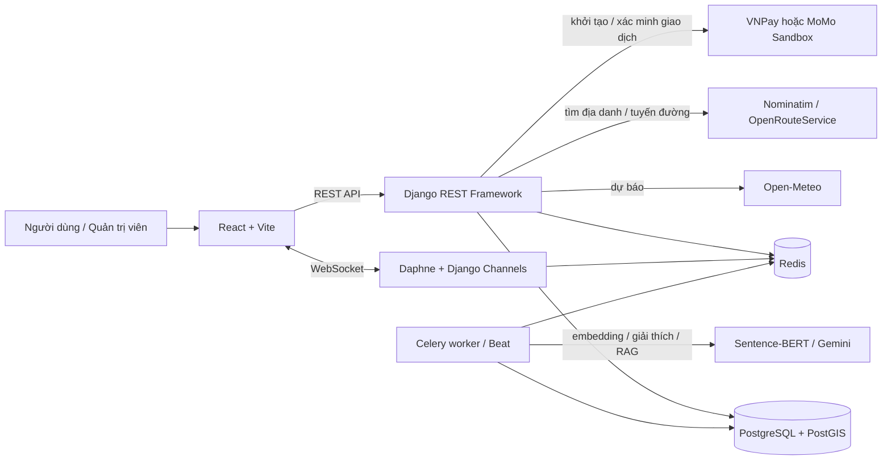

# Sổ tay báo cáo và bảo vệ đồ án

> Tài liệu này được đối chiếu với `Decuong.md`, README và mã nguồn hiện tại. Đây là nội dung để luyện trình bày, không phải khẳng định rằng mọi tích hợp bên ngoài luôn sẵn sàng. Tour và chỗ ở trong hệ thống là dữ liệu minh họa; thanh toán dùng môi trường sandbox. Trước buổi bảo vệ, hãy chạy thử lại các luồng và thay các ví dụ minh họa bằng kết quả thực tế của lần demo.

## 1. Đề tài trong một phút

**Tên đề tài:** Xây dựng website đặt tour du lịch thông minh tích hợp AI.

**Bài toán:** Người đi du lịch thường phải tự tra cứu điểm đến, thời tiết, chi phí, khoảng cách, chỗ ở và tour ở nhiều nơi. Website gom các thao tác này vào một quy trình: nhập nhu cầu, nhận danh sách điểm đến được xếp hạng và giải thích, lập hành trình, xem chỗ ở/tour, đặt dịch vụ và thanh toán thử nghiệm.

**Điểm kỹ thuật chính:** Đây không chỉ là website CRUD. Phần gợi ý kết hợp Sentence-BERT và cosine similarity cho sở thích, logic mờ cho thời tiết, hàm tuyến tính cho ngân sách, Haversine cho khoảng cách và Weighted Sum Model để xếp hạng. Phần còn lại biến kết quả gợi ý thành các luồng nghiệp vụ có tài khoản, tồn kho, thanh toán, đánh giá và quản trị.

**Mẫu mở đầu khi báo cáo:**

> “Em thực hiện đề tài website du lịch thông minh nhằm hỗ trợ người dùng chọn điểm đến theo sở thích, thời tiết dự kiến, ngân sách và khoảng cách. Hệ thống dùng Sentence-BERT để biểu diễn ngữ nghĩa sở thích, logic mờ để chấm thời tiết, sau đó tổng hợp bằng Weighted Sum Model. Ngoài gợi ý, người dùng có thể lập hành trình, đặt phòng hoặc tour và thử thanh toán trên sandbox. Dữ liệu tour và chỗ ở được ghi rõ là dữ liệu minh họa phục vụ kiểm thử nghiệp vụ.”

## 2. Phạm vi và điều cần nói chính xác

### Đã triển khai theo phạm vi đề cương

- Tài khoản: đăng ký, đăng nhập, đăng xuất, hồ sơ, đổi mật khẩu và đặt lại mật khẩu qua email theo cấu hình.
- Gợi ý điểm đến theo các tiêu chí có dữ liệu; có thể bỏ tiêu chí sở thích, ngân sách hoặc khoảng cách khi người dùng không nhập.
- Dự báo thời tiết tối đa 16 ngày và lựa chọn thời tiết cân bằng, mát, ấm hoặc ít mưa.
- Giải thích gợi ý bất đồng bộ qua Celery; nếu Gemini không sẵn sàng hoặc đầu ra không qua kiểm tra thì có phần giải thích nội bộ từ dữ liệu đã tính.
- Điểm đến, chỗ ở, loại phòng, tiện ích, tour, điểm dừng tour và ngày khởi hành; giao diện quản trị cho dữ liệu tương ứng.
- Đặt phòng và đặt tour, xem lịch sử, hủy theo chính sách và theo dõi trạng thái hoàn tiền.
- VNPay Sandbox và MoMo Sandbox là hai lựa chọn độc lập; còn chế độ thanh toán mô phỏng chỉ dùng khi được bật cấu hình.
- Bản đồ Leaflet, tuyến đường từ OpenRouteService khi gọi thành công, chỗ ở quanh điểm đến qua PostGIS, cộng đồng, đánh giá và chat realtime.
- Trợ lý du lịch truy xuất dữ liệu công khai bằng RAG; trang Giới thiệu có nội dung quản trị được.

### Giới hạn cần chủ động thừa nhận

- Tour và chỗ ở là **dữ liệu demo**, không phải danh sách cung cấp dịch vụ thật. Giá và tồn kho chỉ phục vụ kiểm thử luồng.
- VNPay/MoMo là sandbox: không thu tiền thật. IPN thực tế chỉ kiểm chứng được khi cổng thanh toán gọi được URL backend công khai; test tự động mô phỏng callback không thay thế xác nhận trên môi trường merchant thật.
- Dự báo thời tiết bị giới hạn bởi cửa sổ 16 ngày và độ sẵn có của Open-Meteo. Khi không có dữ liệu, điểm thời tiết trung tính 0,5 được đánh dấu `weather_available=false`.
- OpenRouteService có thể lỗi, thiếu khóa hoặc không tìm được tuyến; khi đó hệ thống trả khoảng cách Haversine và hình học đường thẳng ước tính. Google Maps chỉ là lựa chọn mở ứng dụng điều hướng, không phải điều hướng turn-by-turn bên trong website.
- Gemini tạo câu chữ giải thích, **không quyết định điểm xếp hạng**. Có kiểm tra số liệu; khi lỗi hoặc nội dung không hợp lệ sẽ dùng câu giải thích nội bộ.
- Môi trường hiện tại đã từng được đưa ra Internet qua Cloudflare Tunnel nhưng backend vẫn chạy trên máy cá nhân. URL chỉ hoạt động khi máy, Docker, frontend và tunnel còn chạy; đây chưa phải hosting production ổn định.
- Có hai lỗi giao diện/luồng người dùng đã được báo gần đây cần kiểm tra lại trước khi demo: trang kế hoạch gặp Error Boundary khi thêm điểm thứ hai/chỉnh ngày; một số chữ trên bài cộng đồng có tương phản thấp. Không nên trình diễn các đường đi này trước khi xác nhận đã sửa và chạy lại.

## 3. Kiến trúc tổng thể



**Vai trò từng phần:**

| Thành phần | Vai trò trong dự án |
|---|---|
| React + Vite | Trang web, biểu mẫu, hiển thị kết quả, bản đồ Leaflet và gọi API. |
| Django REST Framework | Xác thực, kiểm tra dữ liệu/quyền, nghiệp vụ đặt chỗ, gợi ý và API. |
| PostgreSQL/PostGIS | Lưu người dùng, điểm đến, phòng, tour, đơn; lưu điểm không gian và truy vấn bán kính. |
| Redis | Broker/result backend cho Celery, channel layer cho WebSocket và cache thời tiết/tri thức. |
| Celery | Việc nền tốn thời gian: embedding, làm mới cache thời tiết, diễn giải AI, xử lý tác vụ RAG và phân tích câu tự nhiên. |
| Django Channels/Daphne | Kết nối chat thời gian thực qua WebSocket. |
| Docker Compose | Chạy các dịch vụ backend, Celery, Redis và cơ sở dữ liệu trong môi trường phát triển. |

**Cách diễn đạt:** “Frontend không truy cập cơ sở dữ liệu trực tiếp. Mọi nghiệp vụ đi qua backend; backend xác thực người dùng, kiểm tra quyền và lưu dữ liệu. Redis không thay PostgreSQL: Redis phục vụ hàng đợi/cache/thông điệp realtime, PostgreSQL là nơi lưu dữ liệu nghiệp vụ lâu dài.”

## 4. Mô hình dữ liệu và quan hệ nghiệp vụ

Các model tiêu biểu trong `backend/core/models.py`:

| Nhóm | Model | Ý nghĩa và liên hệ chính |
|---|---|---|
| Tài khoản | `User`, `UserProfile` | Tài khoản Django; hồ sơ lưu sở thích, ngân sách, thời tiết mong muốn và cờ demo. |
| Gợi ý | `Destination`, `RecommendationLog`, `RecommendationFeedback`, `UserCriteriaWeight`, `SearchHistory` | Điểm đến có tọa độ, category, địa chỉ, chi phí tham khảo và embedding; log/feedback phục vụ xếp hạng và cá nhân hóa; lịch sử gắn với người dùng. |
| Chỗ ở | `Accommodation`, `Amenity`, `RoomType` | Một điểm đến có thể có nhiều chỗ ở; chỗ ở có nhiều loại phòng; tiện ích lưu bằng danh sách khóa và khóa được quản lý trong `Amenity`. |
| Đặt phòng | `Booking`, `AccommodationReview` | Đơn nối người dùng với loại phòng và ngày nhận/trả; đánh giá gắn đơn bằng quan hệ một-một tùy chọn để tương thích dữ liệu cũ. |
| Tour | `Tour`, `TourStop`, `TourDeparture`, `TourBooking` | Tour có nhiều điểm dừng theo ngày, nhiều lịch khởi hành; đơn đặt nối người dùng với ngày khởi hành và số khách. |
| Thanh toán | trường giao dịch trên `Booking`/`TourBooking` | Lưu nhà cung cấp, mã tham chiếu, mã giao dịch, trạng thái và thông tin hoàn tiền. |
| Cộng đồng | `TravelPost`, `TravelPostLike` | Bài chia sẻ, ảnh, điểm đến liên quan và lượt thích; mỗi người chỉ có một lượt thích trên một bài. |
| Chat | `ChatMessage` | Hội thoại gắn với người dùng, người gửi, loại tệp đính kèm, cờ admin và trạng thái đã đọc. |
| Trợ lý | `KnowledgeChunk` | Đoạn tri thức có nguồn, metadata, nội dung, hash và embedding để truy xuất RAG. |
| Nội dung | `SitePage`, `SitePageSection` | Nội dung trang Giới thiệu do admin quản lý dưới dạng văn bản thuần và các phần có thứ tự/bố cục. |

**Ví dụ quan hệ đặt phòng:** Một `Accommodation` có các `RoomType`; user tạo `Booking` cho một loại phòng trong khoảng `check_in`–`check_out`. Số đêm = ngày trả trừ ngày nhận; tiền dự kiến = giá một đêm × số đêm. Số điện thoại liên hệ được mã hóa trước khi lưu.

**Ví dụ quan hệ tour:** `Tour` có `TourStop` ngày 1, ngày 2... và `TourDeparture` cho từng ngày khởi hành. `TourBooking` gắn với một departure, ghi người lớn/trẻ em, phòng đơn nếu có và tổng tiền.

## 5. Chức năng gợi ý: giải thích từ đầu đến cuối

### 5.1. Dữ liệu đầu vào

Form nhận sở thích (nhãn hoặc chữ tự do), ngân sách, ngày đi, thời tiết mong muốn và vị trí xuất phát. Vị trí có thể chọn bằng tìm kiếm địa danh hoặc Geolocation. Ngày đi được giới hạn trong cửa sổ dự báo 16 ngày. Hồ sơ đăng nhập có thể cung cấp giá trị mặc định; người dùng vẫn sửa được.

Backend làm sạch sở thích: bỏ khoảng trắng thừa, ký tự điều khiển và giới hạn 200 ký tự. Nhãn quen thuộc được mở rộng trước khi encode, ví dụ:

| Nhãn | Văn bản ngữ nghĩa được mở rộng |
|---|---|
| biển | Du lịch biển, bãi biển cát trắng, tắm biển, đảo, hải sản, nghỉ dưỡng ven biển |
| núi | Du lịch núi, rừng, cao nguyên, trekking, leo núi, ruộng bậc thang, khí hậu vùng cao |
| ẩm thực | Du lịch ẩm thực, món ăn địa phương, đặc sản, chợ, quán ăn, trải nghiệm nấu ăn |

### 5.2. Điểm sở thích – Sentence-BERT và cosine

`encode_text()` dùng mô hình pretrained `paraphrase-multilingual-MiniLM-L12-v2` trên CPU để biến câu thành vector. Vector truy vấn được so với embedding mỗi điểm đến bằng cosine similarity:

`cosine(A,B) = (A · B) / (||A|| × ||B||)`

Embedding điểm đến tạo từ tên + category + địa chỉ + mô tả. Vector được lưu trên bản ghi và tính lại nền khi nội dung liên quan thay đổi. Dữ liệu điểm đến ban đầu có thể được tính lười khi gợi ý nếu vector chưa có.

Điểm cosine gốc trả ra trong `preference_raw`. Khi cosine lớn nhất vượt ngưỡng cấu hình `PREFERENCE_MATCH_MIN` (mặc định 0,30), điểm được min-max chuẩn hóa trên tập ứng viên để tăng khả năng phân biệt. Nếu không điểm nào khớp rõ, không kéo giãn điểm; phản hồi `preference_matched=false` và ghi chú để người dùng hiểu hệ thống không thấy tương quan ngữ nghĩa rõ ràng. Không nhập sở thích thì bỏ hẳn tiêu chí.

### 5.3. Điểm thời tiết – logic mờ

Backend lấy nhiệt độ cao nhất, xác suất mưa lớn nhất và gió lớn nhất trong ngày đi từ Open-Meteo. Cache Redis lưu số liệu thô theo địa điểm/ngày, dùng chung cho mọi lựa chọn thời tiết; điểm được tính sau khi đọc cache.

Hàm thành viên nhiệt độ dạng hình thang. Với lựa chọn cân bằng, các mốc là 15–24–30–40 °C: ngoài khoảng điểm thấp; từ 24 đến 30 °C điểm nhiệt đạt 1; các đoạn chuyển tiếp tăng/giảm tuyến tính. Mưa và gió cũng được đổi thành mức phù hợp trong [0,1].

| Tùy chọn | Mốc nhiệt (°C) | Trọng số nhiệt / mưa / gió |
|---|---|---|
| Cân bằng | 15–24–30–40 | 0,5 / 0,3 / 0,2 |
| Mát | 12–16–24–30 | 0,5 / 0,3 / 0,2 |
| Nắng ấm | 24–28–33–40 | 0,5 / 0,3 / 0,2 |
| Ít mưa | 15–24–30–40 | 0,3 / 0,5 / 0,2 |

`Weather_Score = wT × μnhiệt + wM × μmưa + wG × μgió`, tổng ba trọng số bằng 1. Nếu dịch vụ lỗi hoặc ngày không có dữ liệu, hệ thống ghi `weather_available=false` và dùng 0,5 trung tính thay vì làm hỏng toàn bộ kết quả.

### 5.4. Điểm ngân sách

Mỗi điểm đến dùng `reference_cost`, chi phí tham khảo một người cho chuyến khoảng 3 ngày 2 đêm. Nếu trường này bằng 0, hệ thống dùng mức mặc định theo category.

```text
nếu Cost ≤ Budget: Budget_Score = 1
nếu Cost > Budget: Budget_Score = max(0, 1 − (Cost − Budget) / Budget)
```

Ngân sách bỏ trống hoặc bằng 0 thì tiêu chí không tham gia; response ghi `budget_score=null`. Ví dụ minh họa: chi phí tham khảo 4.200.000đ và ngân sách 6.000.000đ thì điểm ngân sách là 1; nếu ngân sách 3.000.000đ thì điểm = max(0, 1 − 1.200.000/3.000.000) = 0,6. Đây là ví dụ số học, không phải cam kết giá dịch vụ thật.

### 5.5. Điểm khoảng cách

Khoảng cách đường chim bay từ vị trí xuất phát đến điểm đến tính bằng Haversine, bán kính Trái Đất xấp xỉ 6.371 km. Điểm chuẩn hóa theo `DISTANCE_MAX_KM` (mặc định 1.000 km):

`Distance_Score = 1 − min(d / d_max, 1)`

Không chọn vị trí xuất phát thì `distance_score=null`, tiêu chí bị bỏ. Đây là khoảng cách địa lý phục vụ xếp hạng, không phải số km đi đường. Tuyến đường thực tế được gọi riêng qua OpenRouteService.

### 5.6. Tổng hợp và trọng số cá nhân hóa

Trọng số nền hiện tại: sở thích 0,40; thời tiết 0,25; ngân sách 0,20; khoảng cách 0,15. Weighted Sum:

`Final_Score = Σ(wᵢ × scoreᵢ)`

Nếu thiếu sở thích, ngân sách hoặc vị trí, trọng số tương ứng được bỏ và các trọng số còn lại chuẩn hóa lại để tổng vẫn bằng 1. Thời tiết luôn có vì ngày đi là đầu vào bắt buộc. Response có `weights_used`, `criteria_used` và `notes` để giải thích tiêu chí nào tham gia.

Khi đã có tối thiểu 5 phản hồi đủ điểm và có cả nhóm `booked` lẫn `ignored`, hệ thống so sánh điểm trung bình theo từng tiêu chí giữa hai nhóm. Tiêu chí có chênh lệch `booked - ignored` lớn nhất được tăng 0,02; một tiêu chí đang có trọng số cao nhất được giảm tương ứng. Có giới hạn mỗi trọng số 0,1–0,6 và tổng bằng 1. Đây là điều chỉnh quy tắc minh bạch, không phải huấn luyện mô hình phức tạp.

### 5.7. Ví dụ trình bày một kết quả

Giả sử người dùng chọn “biển, ẩm thực”, ngân sách 6 triệu, điểm xuất phát TP.HCM, ngày đi nằm trong giới hạn dự báo. Một thẻ có thể minh họa:

| Thành phần | Điểm ví dụ |
|---|---:|
| Sở thích | 0,90 |
| Thời tiết | 0,82 |
| Ngân sách | 1,00 |
| Khoảng cách | 0,75 |

Với trọng số nền, điểm tổng minh họa là `0,40×0,90 + 0,25×0,82 + 0,20×1 + 0,15×0,75 = 0,8775`, tương đương 87,75%. **Các số trên chỉ để giải thích cách tính; không phải response đã ghi nhận từ một lần chạy thực tế.** Trong demo, hãy mở response API hoặc thẻ thật và đọc đúng các con số tại thời điểm đó.

## 6. Các luồng chức năng chính

### 6.1. Tìm gợi ý và giải thích

1. Người dùng nhập tiêu chí hoặc chọn “Tìm lại” trong lịch sử.
2. Frontend gửi GET `/api/recommendations/`.
3. Backend kiểm tra ngày, tham số thời tiết, tọa độ và ngân sách; lấy trọng số mặc định hoặc trọng số cá nhân.
4. Backend tạo embedding sở thích, lấy dự báo thời tiết cho các điểm đến (gọi song song khi cache miss), tính điểm và xếp hạng. Phần xếp hạng vẫn đồng bộ để trả danh sách ngay.
5. Nếu đã đăng nhập, backend lưu SearchHistory và log các điểm đến đã xếp hạng.
6. Frontend gửi điểm hạng đầu cùng bộ tiêu chí hiện tại tới `/api/recommendations/explain/`; backend trả task id, Celery xử lý Gemini.
7. Frontend poll `/api/tasks/<task_id>/status/`; task trả `source=gemini` hoặc `source=local`. Nếu hết thời gian/lỗi, frontend dùng câu dự phòng.

**Điểm cần nhấn mạnh:** Celery không tính luồng điểm xếp hạng chính; nó dành cho việc nền. Thời tiết cache được làm mới định kỳ, nhưng khi cache miss yêu cầu gợi ý vẫn có đường gọi Open-Meteo trực tiếp song song.

### 6.2. Tìm kiếm bằng câu tự nhiên

Ví dụ: “Cuối tuần này đi biển, ngân sách 5 triệu, trời mát, xuất phát từ TP.HCM”.

1. API `/api/recommendations/parse-query/` chuẩn hóa câu và trả kết quả quy tắc dự phòng ngay.
2. Celery có thể gọi Gemini để trích xuất schema: nhãn sở thích, chữ tự do, ngân sách, ngày, thời tiết, số ngày, số khách và nơi xuất phát.
3. Backend kiểm tra schema/range/ngày; nếu đầu ra model không hợp lệ thì giữ kết quả rule-based.
4. Người dùng xem lại các trường đã điền và tự chọn vị trí cụ thể trước khi tìm gợi ý.

Đây là tính năng nhập liệu tiện lợi, không phải Gemini tự quyết định thứ hạng điểm đến.

### 6.3. Trợ lý du lịch RAG

1. Lệnh `build_knowledge_index` lấy tri thức công khai từ điểm đến, chỗ ở, loại phòng, tour, trang nội dung và chính sách để tạo `KnowledgeChunk`.
2. Câu hỏi được chuẩn hóa và embedding; hệ thống tìm các chunk gần nhất bằng cosine, có ưu tiên tên điểm đến và lọc tour/chỗ ở vượt ngân sách nếu nhận diện được ngân sách.
3. Nếu có nguồn đủ ngưỡng, Celery gửi câu hỏi cùng các đoạn đã truy xuất cho Gemini.
4. Câu trả lời phải có trích dẫn `[n]`, số liệu phải nằm trong nguồn; nếu không qua kiểm tra, hệ thống trả nội dung trích xuất từ chunk. Không có nguồn phù hợp thì từ chối đoán.

**Ví dụ hỏi:** “Tour nào dưới 5 triệu?” Trợ lý chỉ được trả lời nếu chỉ mục có tour và mức giá tương ứng; không được tự bịa tour. Nội dung này dựa trên dữ liệu công khai, không truy cập đơn hàng hoặc thông tin cá nhân.

### 6.4. Lập kế hoạch nhiều điểm

Người dùng thêm điểm đến, đặt thứ tự/ngày dự kiến; kế hoạch trình duyệt lưu cục bộ, không phải đặt tour. Bản đồ nối vị trí xuất phát → điểm 1 → điểm 2 theo thứ tự; có thể xem từng chặng. Mỗi chặng gọi route API để lấy geometry, km và thời gian; có fallback Haversine. Trang có thể bổ sung dự báo và chỗ ở gần từng điểm.

**Phân biệt khi bảo vệ:** Kế hoạch cá nhân là công cụ phác thảo lịch đi; `Tour` là sản phẩm tour do quản trị viên biên soạn và có ngày khởi hành/tồn chỗ để đặt. Lập kế hoạch không tự tạo Booking/TourBooking và không thu tiền.

> **Cần kiểm thử trước demo:** đã có báo cáo rằng thêm điểm thứ hai rồi đổi ngày làm trang rơi vào Error Boundary. Hãy xác nhận nguyên nhân đã được sửa, thêm hai điểm, đổi ngày, xóa điểm, F5 và thử lại trên màn hình nhỏ. Nếu chưa sửa, không trình diễn tính năng này như đã ổn định.

### 6.5. Đặt phòng

1. Từ chi tiết chỗ ở, người dùng chọn loại phòng; mã `roomTypeId` nằm trên URL `/dat-phong/<id>` nên tải lại vẫn có thể lấy lại dữ liệu.
2. Backend kiểm tra ngày nhận/trả, số đêm, loại phòng và tồn kho giao nhau trong khoảng ngày.
3. Tạo `Booking` trạng thái `pending`, lưu giá trị tiền và số điện thoại đã mã hóa.
4. Người dùng chọn cổng; backend tính số tiền từ dữ liệu đơn, không tin giá tiền client gửi.
5. Sau callback hợp lệ, đơn chuyển `confirmed`; nếu thất bại, luồng callback xử lý trạng thái theo quy tắc của nhà cung cấp.

Chống trùng phòng dựa trên đếm đơn `pending`/`confirmed` giao nhau với khoảng ngày cần đặt và khóa transaction tại luồng tạo đơn. Khi thuyết trình về mức tải thực tế, chỉ nêu kết quả test đồng thời nếu đã chạy và có log/test report gần nhất.

### 6.6. Đặt tour

1. Người dùng chọn tour và departure.
2. Nhập người lớn/trẻ em; backend kiểm tra departure còn hoạt động, số khách hợp lệ và số chỗ còn lại.
3. Giá được tính server từ giá người lớn, trẻ em và phụ thu phòng đơn nếu có.
4. Tạo `TourBooking` pending rồi đi qua luồng thanh toán tương tự đặt phòng.

### 6.7. Thanh toán, callback và hoàn tiền

Trong giao diện người dùng có thể chọn VNPay hoặc MoMo; cả hai là môi trường sandbox. Backend tạo URL/phiên giao dịch bằng số tiền tính từ đơn. Khi người dùng quay lại, backend xác minh chữ ký và dữ liệu đơn trước khi xác nhận. IPN là request server-to-server riêng, được xác minh chữ ký; cập nhật trạng thái có tính lặp an toàn. Hàm dùng chung `_apply_payment_result` áp dụng kết quả xác nhận, lưu mã giao dịch và ghi phản hồi liên quan khi giao dịch thành công lần đầu.

Hủy đơn lấy số tiền hoàn từ server. Đơn phòng: tối thiểu còn 1 ngày mới được tự hủy; hoàn 100% khi còn từ 3 ngày, 50% khi còn 1–2 ngày. Tour: tối thiểu còn 3 ngày; hoàn 100% từ 7 ngày, 50% từ 3–6 ngày. Đơn pending chưa thanh toán có tiền hoàn bằng 0. Admin có thể hủy và nhập số tiền hoàn theo quyền quản trị. Kết quả hoàn có trạng thái.

**Ví dụ:** đơn phòng đã xác nhận, còn 4 ngày tới check-in, tổng đơn 2.000.000đ → preview hoàn 100% = 2.000.000đ. Nếu còn 2 ngày → 50% = 1.000.000đ. Đơn pending → 0đ. Đây là phép minh họa chính sách; backend là nguồn tính tiền chính thức.

**Cần nói đúng:** Sandbox chứng minh luồng kỹ thuật kiểm thử, không phải tiền thật. Hủy đơn và gửi request refund là hai bước nghiệp vụ; trạng thái `failed` có thể xảy ra nếu cổng từ chối hoặc lỗi mạng.

### 6.8. Tìm chỗ ở quanh điểm đến và bản đồ

Điểm đến/chỗ ở giữ tọa độ và `Point` SRID 4326. API dùng truy vấn PostGIS để lọc bán kính theo mét, tính khoảng cách rồi sắp xếp gần trước. Trên UI người dùng chọn bán kính; dữ liệu seed được phân bố theo nhiều khoảng cách để số chỗ phù hợp thay đổi theo bán kính.

Route API gọi OpenRouteService bằng tọa độ `[longitude, latitude]`; response GeoJSON được chuyển thành các cặp `[latitude, longitude]` cho Leaflet. Khi không có tuyến thật, Haversine cho khoảng cách chim bay và thời lượng ước tính theo tốc độ giả định; UI cần gọi rõ là **ước tính**.

### 6.9. Chat realtime

1. Frontend mở WebSocket đến nhóm hội thoại tương ứng khi phiên đã xác thực.
2. Middleware xác thực người dùng; consumer chỉ cho user vào phòng của chính mình, staff có thể xem phòng người dùng.
3. Tin nhắn lấy sender từ phiên đã xác thực, lưu `ChatMessage`, rồi broadcast qua channel layer Redis cho các phía.
4. Nhóm thông báo riêng phát số chưa đọc; REST cung cấp lịch sử có phân trang, danh sách hội thoại admin và đánh dấu đã đọc.
5. Kết nối ping/pong định kỳ, client tự nối lại khi mất kết nối ngoài ý muốn.

**Demo:** mở hai trình duyệt/ẩn danh, một tài khoản user và một admin; gửi tin hai chiều, kiểm tra tin xuất hiện tức thời, số chưa đọc thay đổi khi chat đóng, và tin được đánh dấu đã đọc khi mở cuộc trò chuyện.

### 6.10. Cộng đồng, đánh giá và admin

- Bài cộng đồng gắn user, nội dung, ảnh và điểm đến; lượt thích có ràng buộc không trùng theo user/bài.
- Đánh giá chỗ ở gắn với đơn đặt phòng; điều kiện theo code gồm đơn của user, đã confirmed, checkout đã qua và chưa đánh giá đơn đó.
- Admin quản lý danh mục điểm đến/chỗ ở/phòng/tiện ích/tour/điểm dừng/lịch khởi hành, đơn và thống kê; sửa nội dung trang Giới thiệu.
- Dữ liệu demo có thể được đánh dấu để phân biệt với dữ liệu người dùng thật và loại khỏi một số thống kê.

## 7. Bảo mật và độ tin cậy

- Cookie session/CSRF dùng cơ chế xác thực hiện có; auth context frontend có trạng thái loading/authenticated/anonymous để tránh chuyển hướng sớm khi tải lại.
- Route cần đăng nhập và route staff được bảo vệ; backend tiếp tục kiểm tra quyền sở hữu từng đơn/tài nguyên. Không dựa riêng vào ẩn nút ở frontend.
- Số điện thoại trong đơn dùng mã hóa đối xứng Fernet; khóa lấy từ biến môi trường, không lưu cùng dữ liệu mã hóa.
- Payment callback/IPN kiểm tra chữ ký, mã giao dịch và số tiền theo đơn phía server.
- Consumer chat xác thực và phân quyền phòng; sender lấy từ tài khoản đã xác thực, không tin sender id trong payload.
- Lời giải thích Gemini/RAG được kiểm tra số liệu và nguồn; fallback tránh để tác vụ nền kẹt vô hạn.
- Input/URL quản trị cần được validate; nội dung trang Giới thiệu render như văn bản an toàn, không render HTML thô.

## 8. Bảng chức năng và nơi tìm trong mã nguồn

| Nội dung | File chính để mở khi được hỏi |
|---|---|
| Định tuyến và bảo vệ trang | `frontend/src/App.jsx`, `frontend/src/components/RouteGuards.jsx` |
| Form và thẻ gợi ý | `frontend/src/components/RecommendationForm.jsx`, `frontend/src/components/DestinationCard.jsx`, `frontend/src/pages/RecommendationsPage.jsx` |
| Tính điểm gợi ý và API | `backend/core/views.py` (`_recommendation_results`, `recommendation_view`) |
| Embedding | `backend/core/embedding.py`, `backend/core/tasks.py` |
| Logic mờ/cache thời tiết | `backend/core/weather_utils.py`, `backend/core/views.py`, `backend/core/tasks.py` |
| Trọng số cá nhân | `backend/core/recommendation_weights.py`, model trong `backend/core/models.py` |
| Câu tự nhiên | `backend/core/natural_language.py`, `backend/core/tasks.py`, `frontend/src/components/NaturalQueryBox.jsx` |
| Trợ lý RAG | `backend/core/rag.py`, `backend/core/tasks.py`, `frontend/src/pages/TravelAssistantPage.jsx` |
| Đặt phòng/tour/thanh toán | `backend/core/views.py`, `backend/core/cancellations.py`, `frontend/src/pages/BookingPage.jsx`, `frontend/src/pages/ToursPages.jsx` |
| Chat | `backend/core/consumers.py`, `backend/core/routing.py`, `backend/config/asgi.py`, `frontend/src/components/ChatConnection.jsx`, `frontend/src/components/ChatWidget.jsx`, `frontend/src/pages/AdminPages.jsx` |
| Bản đồ/kế hoạch | `backend/core/views.py` (`route_planning`), `frontend/src/RouteMap.jsx`, `frontend/src/pages/TripPlanPage.jsx`, `frontend/src/tripPlan.js` |
| Model/API | `backend/core/models.py`, `backend/core/serializers.py`, `backend/core/urls.py` |

## 9. Kịch bản demo đề xuất (8–12 phút)

### Chuẩn bị trước

1. Mở backend, Redis, Celery và frontend; kiểm tra trang chủ/API health.
2. Đăng nhập sẵn một user và một admin ở hai hồ sơ trình duyệt riêng.
3. Kiểm tra ngày hệ thống và khả năng lấy dự báo; chọn ngày trong 16 ngày.
4. Chuẩn bị sẵn dữ liệu điểm đến, tour, phòng; kiểm tra cổng VNPay Sandbox đã cấu hình nếu định demo thanh toán.
5. Nếu dùng tunnel, xác nhận tunnel đang chạy, URL truy cập được từ mạng di động và mở được API qua URL đó. Không để lộ `.env`, API key, token tunnel hay khóa thanh toán khi chia sẻ màn hình.

### Trình tự nói và thao tác

1. **Trang chủ:** giới thiệu nhanh mục tiêu sản phẩm.
2. **Gợi ý:** nhập “biển, ẩm thực”, ngân sách, ngày và vị trí xuất phát; chỉ ra điểm tổng và 4 điểm thành phần, trọng số, ghi chú tiêu chí. Giải thích riêng rằng thẻ AI sinh sau khi danh sách được xếp hạng.
3. **Chi tiết điểm đến:** xem thời tiết, bản đồ tuyến, chỗ ở quanh điểm đến và khoảng cách.
4. **Kế hoạch:** thêm hai điểm, đổi thứ tự/ngày, xem từng chặng. Chỉ dùng nếu lỗi thêm điểm thứ hai đã được khắc phục.
5. **Đặt chỗ:** đặt một phòng hoặc tour, chỉ ra kiểm tra tồn kho và số tiền tính ở server.
6. **Thanh toán:** dùng giao dịch sandbox/thẻ test do nhà cung cấp cấp; tuyệt đối không dùng thẻ thật khi demo đồ án.
7. **Hồ sơ:** xem đơn, trạng thái, lịch sử tìm kiếm và thử hủy nếu đơn/điều kiện phù hợp.
8. **Chat:** gửi tin từ user, phản hồi trên admin, chỉ số chưa đọc.
9. **Admin:** cho thấy dữ liệu, trạng thái đơn và thống kê.
10. **Kết:** nhấn mạnh phạm vi demo, giới hạn sandbox và hướng phát triển.

### Câu chuyển giữa các màn hình

- “Kết quả được xếp hạng bằng điểm số; phần giải thích AI chỉ diễn đạt lại dữ liệu đầu vào và điểm đã tính.”
- “Kế hoạch cá nhân khác tour bán sẵn: kế hoạch là lịch nháp; tour có departure và số chỗ để tạo đơn.”
- “Đơn được tạo ở trạng thái chờ thanh toán. Chỉ callback đã xác minh chữ ký mới có thể xác nhận đơn.”
- “Đây là sandbox nên kết quả phục vụ kiểm thử tích hợp, không phát sinh thu tiền thật.”

## 10. Câu hỏi hội đồng có thể hỏi

### “Vì sao dùng Sentence-BERT thay tìm từ khóa?”

Tìm từ khóa chỉ nhận chuỗi trùng hoặc gần trùng. Embedding biểu diễn câu thành vector ngữ nghĩa để so sánh ý tương tự, kể cả người dùng diễn đạt khác nhãn category. Đề tài dùng mô hình pretrained, không tự huấn luyện từ đầu; dữ liệu mô tả điểm đến ảnh hưởng trực tiếp chất lượng embedding.

### “Cosine similarity là gì?”

Đó là cosine góc giữa hai vector. Giá trị càng lớn thì hướng biểu diễn càng gần; hệ thống dùng nó làm mức tương đồng ngữ nghĩa giữa truy vấn sở thích và văn bản điểm đến. Điểm này không tự nó là xác suất đúng.

### “Tại sao dùng logic mờ cho thời tiết?”

Thời tiết phù hợp không phải ranh giới đạt/trượt cứng. Hàm thành viên hình thang chuyển nhiệt độ, mưa và gió thành mức độ từ 0 đến 1, giúp các điều kiện gần nhau thay đổi điểm liên tục. Các lựa chọn thời tiết thay đổi mốc nhiệt hoặc trọng số mưa theo mong muốn.

### “Nếu người dùng không điền đủ tiêu chí?”

Tiêu chí vắng bị loại khỏi tổng điểm; trọng số các tiêu chí còn lại được chuẩn hóa để tổng bằng 1. Vì vậy hệ thống không giả định ngân sách 0 hoặc sở thích rỗng là một sở thích thực.

### “Điểm gợi ý có phải xác suất thành công?”

Không. Đây là điểm tổng chuẩn hóa trong mô hình xếp hạng đa tiêu chí, dùng để so sánh tương đối các ứng viên trong cùng lần tìm.

### “Trọng số tự học thế nào?”

Đây là cập nhật heuristic có giải thích: sau ít nhất 5 phản hồi đủ điểm, so sánh trung bình tiêu chí của các lần đặt và bỏ qua; tăng nhẹ trọng số tiêu chí có tín hiệu tích cực lớn nhất và giảm trọng số khác cùng lượng. Không nên gọi đây là deep learning hay học tăng cường.

### “Gemini có quyết định gợi ý không?”

Không. Quy tắc xếp hạng chạy ở backend trước; Gemini chỉ nhận dữ liệu đã tính để viết giải thích. Nếu thiếu key, lỗi, timeout hay nói số không có trong facts thì hệ thống dùng giải thích local.

### “RAG khác chatbot gọi Gemini trực tiếp thế nào?”

RAG truy xuất các đoạn tri thức có trong hệ thống trước, đưa các đoạn làm bằng chứng cho model, sau đó kiểm tra số liệu và trích dẫn. Chatbot không được tự truy vấn dữ liệu tài khoản/đơn hàng và phải từ chối khi không có bằng chứng.

### “Làm sao tránh đặt vượt tồn kho?”

Backend kiểm tra tồn kho trong transaction và khóa dữ liệu liên quan ở luồng tạo đơn; đồng thời tính số đơn còn hiệu lực giao nhau với khoảng ngày phòng hoặc số khách đã chiếm departure. Không tin số lượng/giá gửi từ frontend. Hãy mở test đồng thời để trình bày bằng chứng cụ thể nếu hội đồng yêu cầu.

### “Tại sao cần cả Return URL và IPN?”

Return URL phục vụ trải nghiệm người dùng quay lại trình duyệt; IPN là thông báo máy chủ tới máy chủ, có thể đến độc lập hoặc trước/sau Return. Cả hai phải xác minh chữ ký và cập nhật idempotent để callback lặp không tạo tác động trùng.

### “Sandbox có nghĩa là thanh toán thật không?”

Không. Sandbox mô phỏng giao dịch và hoàn tiền để kiểm thử tích hợp. Không thu tiền thật, không nên dùng thẻ thật.

### “PostGIS khác tự tính khoảng cách trong Python ra sao?”

PostGIS lưu geometry/geography và thực hiện lọc không gian ngay trong cơ sở dữ liệu, có thể tận dụng spatial index. Haversine trong Python dùng để chấm khoảng cách xuất phát trong gợi ý/fallback tuyến; hai phép toán phục vụ mục đích liên quan nhưng không đồng nhất.

### “Fernet bảo vệ dữ liệu thế nào?”

Fernet là cơ chế mã hóa xác thực đối xứng của thư viện cryptography. Số điện thoại được mã hóa trước khi lưu; khóa nằm ngoài cơ sở dữ liệu trong biến môi trường. Nếu mất khóa thì không giải mã lại được, vì vậy khóa phải được sao lưu/quản lý kín.

### “Hệ thống đã production chưa?”

Nên trả lời trung thực: “Ứng dụng đã được chia sẻ để truy cập từ Internet bằng tunnel tới máy phát triển. Tunnel phụ thuộc máy và các tiến trình local, nên đây là demo truy cập từ xa chứ chưa phải triển khai production có SLA, backup và vận hành liên tục.”

## 11. Hạn chế và hướng phát triển hợp lý

1. Mở rộng, xác minh và gắn nguồn dữ liệu điểm đến; nâng chất lượng mô tả/địa chỉ để embedding có thông tin tốt hơn.
2. Đo chất lượng gợi ý bằng bộ truy vấn/đánh giá có tiêu chí rõ (Precision@K, NDCG hoặc khảo sát người dùng), thay vì chỉ nhìn vài kết quả demo.
3. Theo dõi độ trễ, lỗi dịch vụ và cache; có dashboard/alert và job kiểm tra dữ liệu.
4. Đưa frontend/backend/database lên môi trường triển khai bền vững, thiết lập domain, HTTPS, backup, secrets và logging; chuyển dữ liệu demo thành dữ liệu có giấy phép/đối tác nếu phát hành thật.
5. Tích hợp xác nhận email/điện thoại nếu yêu cầu vận hành thực tế; hiện số điện thoại được thu khi đặt dịch vụ.
6. Hoàn thiện xử lý idempotency/refund theo quy định merchant và thử callback IPN trên URL public do nhà cung cấp chấp nhận.
7. Khắc phục và kiểm thử lỗi trang kế hoạch với nhiều điểm, đồng thời quét tương phản chữ trên toàn bộ thẻ cộng đồng trước demo.

## 12. Checklist trước ngày bảo vệ

- [ ] Đối chiếu chức năng với `Decuong.md`, đánh dấu trạng thái thật; không giới thiệu tính năng đang lỗi là đã hoàn thiện.
- [ ] Chạy toàn bộ test mới nhất và lưu lại kết quả, thời gian, tổng số test.
- [ ] Chạy `npm run build` và kiểm tra lỗi console/network trên các luồng trọng tâm.
- [ ] Xác nhận task Celery/Redis hoạt động, endpoint health trả OK, DB có dữ liệu demo cần thiết.
- [ ] Thử đặt phòng và tour, callback VNPay/MoMo sandbox, hủy/hoàn theo mốc ngày.
- [ ] Thử chat bằng hai phiên trình duyệt riêng.
- [ ] Kiểm tra trang kế hoạch thêm ít nhất hai điểm và đổi ngày; kiểm tra chữ review cộng đồng đọc rõ.
- [ ] Chuẩn bị video/ảnh dự phòng nếu mạng hoặc nhà cung cấp AI/thời tiết/thanh toán gặp sự cố.
- [ ] Không chia sẻ màn hình `.env`, API keys, secret thanh toán, mật khẩu, cookie hoặc token Cloudflare.
- [ ] Chuẩn bị giải thích rõ dữ liệu demo, giới hạn forecast, fallback tuyến và tình trạng hosting.

## 13. Kết luận mẫu

> “Đồ án đã xây dựng được một quy trình du lịch tích hợp từ gợi ý đến đặt dịch vụ, với phần xếp hạng kết hợp embedding ngữ nghĩa, logic mờ và mô hình tổng trọng số. Hệ thống còn có bản đồ/PostGIS, tài khoản, quản trị, chat và các luồng thanh toán sandbox. Giới hạn hiện tại là dữ liệu chỗ ở/tour minh họa, dự báo thời tiết hữu hạn, và môi trường public tunnel phụ thuộc máy cá nhân. Hướng tiếp theo là đánh giá thuật toán trên dữ liệu người dùng có kiểm soát, hoàn thiện kiểm thử các luồng lỗi và triển khai hạ tầng ổn định hơn.”
